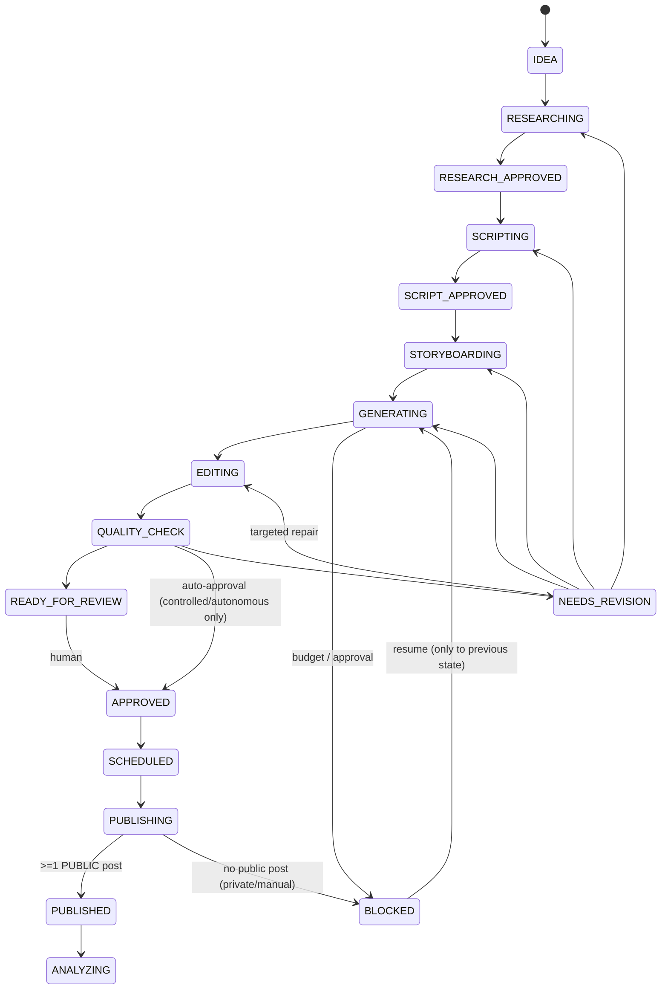

# Architecture

## System diagram

```mermaid
flowchart LR
  subgraph Owner["CEO (you)"]
    D[Dashboard<br/>FastAPI + Jinja<br/>mobile-first]
    N[Email / Telegram / Webhook<br/>daily report + alerts]
  end

  subgraph Core["Core services (one Docker image)"]
    API[api<br/>dashboard + JSON API]
    SCH[scheduler<br/>cron in Asia/Jerusalem<br/>idempotent slots]
    W[worker xN<br/>Postgres SKIP LOCKED queue<br/>retries / dead-letter / heartbeats]
  end

  subgraph Agents["Agents (structured I/O, Pydantic)"]
    A[A · COO<br/>health, inventory,<br/>recovery, reports]
    B[B · Trends<br/>topic discovery + scoring]
    C[C · Research &<br/>fact-check]
    DSc[D · Scriptwriter]
    E[E · Storyboard]
    F[F · Visuals]
    G[G · Voice & audio]
    H[H · Editor]
    QC[QC · technical +<br/>editorial gates]
    P[Publisher]
    AN[Analytics + strategy]
    BIZ[Business:<br/>budget, finance, sponsors]
  end

  subgraph Media["Deterministic media engine"]
    SIM[IDM traffic sim<br/>+ scene templates<br/>Pillow]
    FF[FFmpeg: encode, xfade,<br/>libass captions,<br/>loudnorm, probes]
  end

  subgraph Providers["Swappable providers"]
    LLM[Claude API<br/>+ web_search]
    TTS[ElevenLabs<br/>(Piper dev-only)]
    GEN[Higgsfield API<br/>images / video]
    S3[(S3-compatible storage<br/>or local disk)]
  end

  subgraph Platforms["Official platform APIs"]
    YT[YouTube Data API]
    IG[Instagram Graph API]
    FB[Facebook Reels API]
    TT[TikTok: manual handoff<br/>until audited]
  end

  DB[(PostgreSQL<br/>state, lineage, jobs,<br/>analytics, finance, audit)]

  D <--> API
  API <--> DB
  SCH --> DB
  W <--> DB
  W --> Agents
  A & B & C & DSc & E & QC & AN --> LLM
  G --> TTS
  F --> GEN
  F & H --> Media
  H --> S3
  P --> YT & IG & FB & TT
  AN --> YT & IG & FB
  A --> N
```

## Why this shape

* **One Postgres database is the source of truth** for content state, jobs, money and audit. Binary media
  lives in object storage (local disk in dev, any S3-compatible bucket in production).
* **A durable Postgres job queue instead of n8n** (decision D-002): `SELECT … FOR UPDATE SKIP LOCKED`
  gives safe concurrency, retries with exponential backoff and jitter, dead-lettering, idempotency keys,
  per-type concurrency limits, heartbeats and stalled-job recovery, with no extra service to run.
  n8n can still drive the system through the JSON API (`POST /api/jobs/{type}`) if you want visual workflows later.
* **Deterministic orchestration, LLM-assisted agents.** Agents only produce validated Pydantic objects.
  `waitwhy/pipeline.py` alone moves state, enqueues the next stage and enforces gates. An LLM can't skip
  a stage, spend money, or publish.
* **Hybrid media.** Motion graphics (diagrams, simulations, labels, captions) are rendered
  deterministically, which is cheap, consistent and never hallucinated. Generative video (Higgsfield) is
  limited to `max_ai_scenes_per_video` cinematic shots. The traffic-jam demo uses no generative imagery.
  Its visuals come from a real car-following simulation.

## Content lineage (stable IDs)

`topics` → `videos` (**canonical content ID**) → `research_sources`/`fact_checks` → `scripts` →
`storyboards`/`storyboard_scenes` → `generated_assets`/`voiceovers` → `video_versions` → `quality_reviews`
→ `approvals` → `publication_jobs` (one per platform) → `platform_posts` → `analytics_snapshots`.
Every asset row stores provider, model, prompt, seed, parameters, cost, retries, errors and a rights record.

## Workflow state machine



Any active state can move to `NEEDS_REVISION`, `BLOCKED`, `FAILED` or `CANCELLED`. An invalid transition raises
`InvalidTransition`, so the pipeline never advances silently. Every transition is written to `audit_logs`.

## Job reliability

| Concern | Mechanism |
|---|---|
| Retries | Transient errors → exponential backoff with ±25 % jitter, bounded by `max_attempts` |
| Permanent errors | Auth / policy / validation → `dead` immediately + alert (never retried) |
| Dead letter | `status='dead'`, visible and retryable from **Agents** page |
| Idempotency | unique `idempotency_key` on jobs; unique `(video, platform)` on publications; asset cache keys |
| Concurrency | per-job-type limits (e.g. 1 render at a time, 2 research) |
| Timeouts / recovery | heartbeats every 15 s; `recover_stalled` re-queues jobs whose worker died |
| Budget / approval stops | job parked as `blocked` (no attempt consumed); resumes on approval |
| Graceful shutdown | SIGTERM → finish current job, stop claiming (compose `stop_grace_period: 10m`) |
| Orphans | hourly `production_tick` re-enqueues any in-flight video that lost its job |
| Pause switches | `publishing_paused` (emergency) and `automation_paused` honoured at claim time |

## Daily operations (owner timezone, Asia/Jerusalem)

| Time | Job | What it does |
|---|---|---|
| 07:00 | `health_check` | scheduler/worker heartbeats, DB, storage, credentials, failed/stalled jobs, spend, inventory, bounded auto-fixes |
| 01:30, 07:30, 13:30, 19:30 | `analytics_collect` | per-post snapshots (NULL = unavailable), preliminary vs final; the dashboard's Refresh button runs it on demand |
| 08:00 | `strategy_analysis` | cohort medians per platform; refuses to conclude below n thresholds |
| 08:30 | `content_planning` | keeps inventory at target, budget-aware topic selection |
| 09:00 | `daily_report` | CEO digest: facts / unknowns / 3 recommendations |
| every 5 min | `publish_due`, `recover_stalled` | missed-window detection, stuck-processing alerts, job recovery |
| hourly | `production_tick` | orphan recovery |
| Sun 10:00 | `weekly_review` | 7-day review |
| 1st 10:00 | `monthly_review` | management report |
| 03:30 | `db_backup` | `pg_dump` + optional upload to S3 |

Publication **slots** are defined in the audience timezone (`America/New_York` 12:00 / 17:00 / 19:30 by
default) and rotate until real data shows better slots.
